# AWS VPC Networking Lab – Public & Private Subnet Architecture

## Project Overview

This project demonstrates the design and implementation of a custom AWS Virtual Private Cloud (VPC) with separate public and private subnets.

The goal was to build a secure network architecture where:

- A public EC2 instance can access the Internet through an Internet Gateway.
- A private EC2 instance has no public IP address.
- The private EC2 instance can access the Internet outbound through a NAT Gateway.
- Administrative access to the private EC2 instance is performed through the public EC2 instance acting as a bastion/jump host.
- Security Groups and Route Tables control network access and traffic flow.

This lab provided hands-on experience with AWS networking, subnet segmentation, routing, NAT, security groups, EC2, and Linux network troubleshooting.

---

## Architecture


### Network Design

| Component | Configuration |
|---|---|
| AWS Region | Canada (Central) |
| VPC | `10.0.0.0/16` |
| Public Subnet | `10.0.1.0/24` |
| Private Subnet | `10.0.2.0/24` |
| Public EC2 | Public subnet with public IPv4 address |
| Private EC2 | Private subnet with no public IPv4 address |
| Internet Gateway | Provides Internet connectivity to the public subnet |
| NAT Gateway | Provides outbound Internet connectivity for the private subnet |
| Public Route | `0.0.0.0/0 → Internet Gateway` |
| Private Route | `0.0.0.0/0 → NAT Gateway` |

---

## Architecture Flow

### Public EC2

```text
Internet
   ↓
Internet Gateway
   ↓
Public Route Table
   ↓
Public Subnet
   ↓
Public EC2
```

The public EC2 instance acts as the entry point into the environment and can be accessed through SSH.

### Private EC2 Outbound Internet Access

```text
Private EC2
   ↓
Private Route Table
   ↓
NAT Gateway
   ↓
Internet Gateway
   ↓
Internet
```

The private instance does not require a public IP address to initiate outbound Internet connections.

### Administrative Access to Private EC2

```text
Administrator Laptop
        ↓ SSH
    Public EC2
   (Jump Host)
        ↓ SSH
    Private EC2
```

This keeps the private EC2 instance from being directly exposed to the Internet.

---

# Implementation

## 1. Create the VPC

A custom VPC was created using:

```text
10.0.0.0/16
```

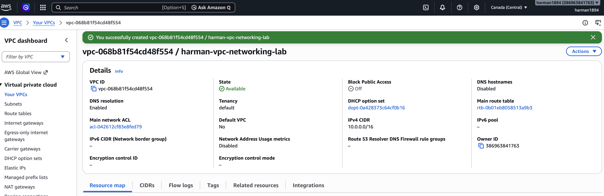

---

## 2. Create Public and Private Subnets

Two subnets were created inside the VPC.

```text
Public Subnet
10.0.1.0/24

Private Subnet
10.0.2.0/24
```

This separates Internet-facing resources from internal resources.

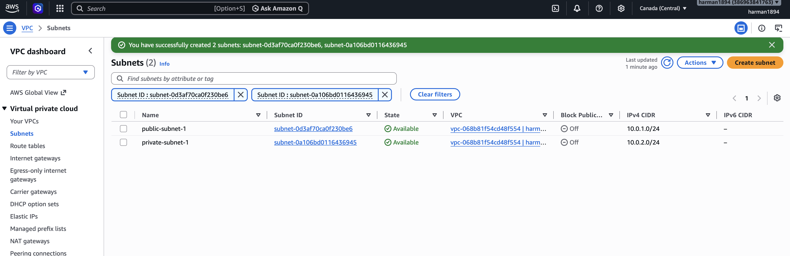

---

## 3. Configure the Internet Gateway

An Internet Gateway was created and attached to the VPC.

The Internet Gateway provides a path between resources in the public subnet and the Internet.

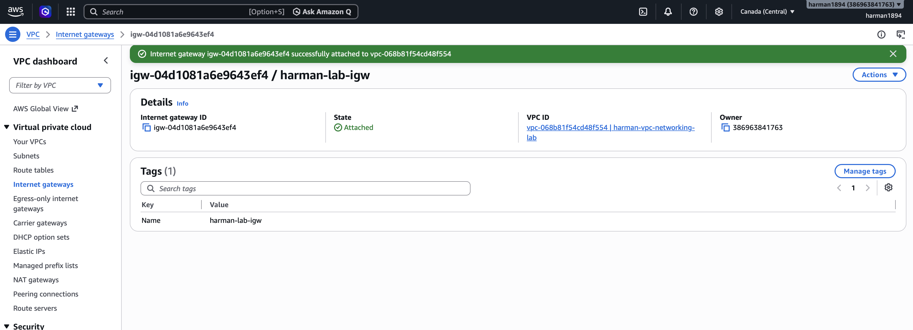

---

## 4. Configure the Public Route Table

A dedicated route table was associated with the public subnet.

The default Internet route was configured as:

```text
Destination: 0.0.0.0/0
Target: Internet Gateway
```

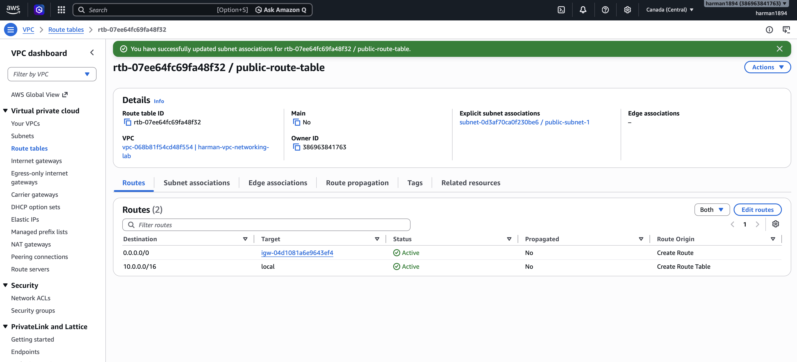

This makes the subnet public for resources that also have an appropriate public IP and security configuration.

---

## 5. Create the NAT Gateway

A public NAT Gateway was deployed to provide outbound Internet connectivity for resources in the private subnet.

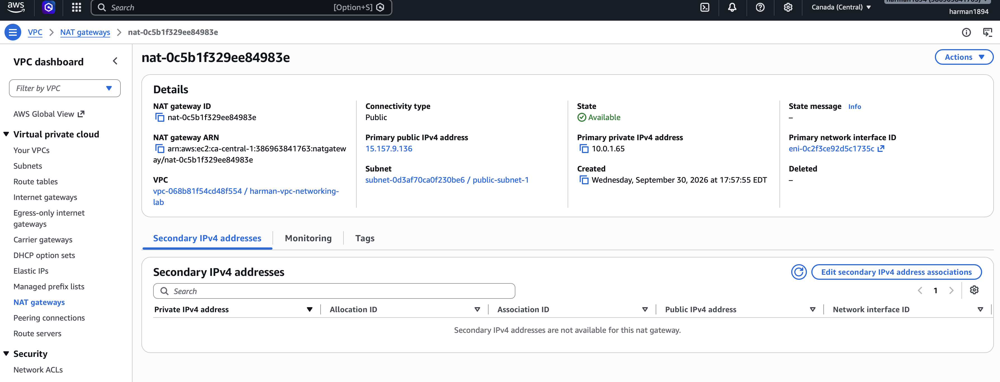

The NAT Gateway allows the private EC2 instance to initiate connections to the Internet without making the instance directly reachable from the Internet.

---

## 6. Configure the Private Route Table

A separate route table was created and associated with the private subnet.

Its default route was configured as:

```text
Destination: 0.0.0.0/0
Target: NAT Gateway
```

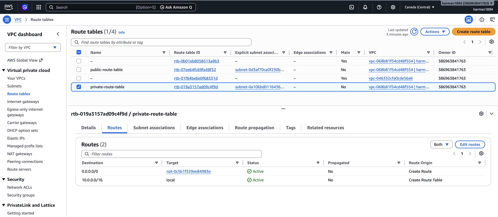

The public and private subnets therefore use different paths for Internet connectivity.

---

## 7. Verify VPC Resource Mapping

The AWS VPC Resource Map was used to verify the relationships between the subnets, route tables, Internet Gateway, and NAT Gateway.

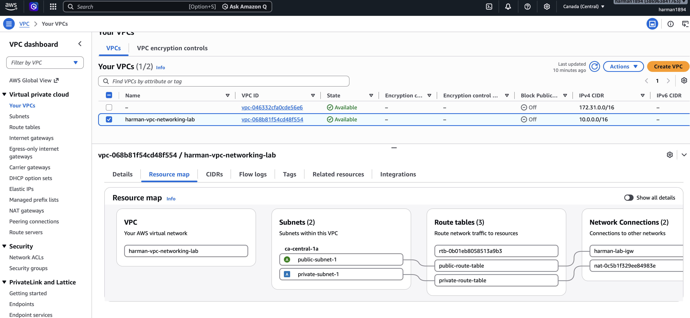

---

## 8. Configure Security Groups

Separate security groups were created for the public and private EC2 instances.

### Public EC2 Security Group

Inbound SSH access:

```text
SSH
TCP 22
Source: Administrator IP
```

### Private EC2 Security Group

Inbound SSH access was restricted to traffic originating from the public EC2 security group.

```text
SSH
TCP 22
Source: public-ec2-sg
```

This prevents direct SSH access to the private instance from the Internet.

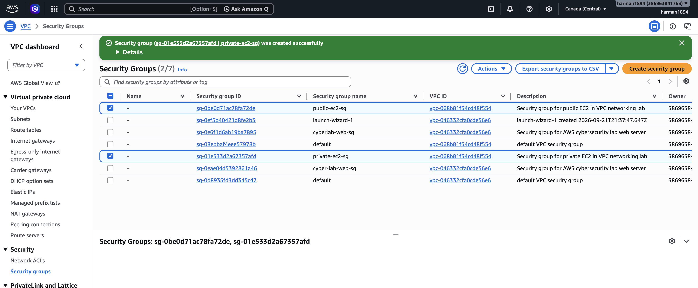

---

## 9. Launch the Public EC2 Instance

A Linux EC2 instance was deployed into the public subnet.

The instance received:

- A private IPv4 address from `10.0.1.0/24`
- A public IPv4 address
- The public EC2 security group

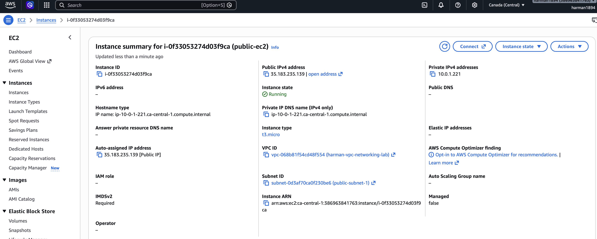

This instance also served as the jump host for accessing the private EC2 instance.

---

## 10. Launch the Private EC2 Instance

A second Linux EC2 instance was deployed into the private subnet.

The instance received a private IP address from:

```text
10.0.2.0/24
```

It was intentionally configured without a public IPv4 address.

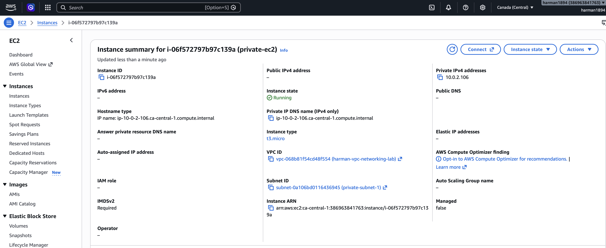

This demonstrates network isolation because the instance is not directly addressable from the public Internet.

---

# Connectivity Testing

## 11. Test SSH Access to the Public EC2 Instance

SSH connectivity from the administrator workstation to the public EC2 instance was tested successfully.

Example:

```bash
ssh -i aws-cyber-lab-key.pem ec2-user@<PUBLIC-IP>
```

Network information was verified using:

```bash
hostname
ip addr
curl https://checkip.amazonaws.com
```


---

## 12. SSH from Public EC2 to Private EC2

SSH agent forwarding was used so the private key did not need to be copied onto the public EC2 instance.

From the local workstation:

```bash
eval "$(ssh-agent -s)"
ssh-add ~/Downloads/aws-cyber-lab-key.pem
ssh -A -i ~/Downloads/aws-cyber-lab-key.pem ec2-user@<PUBLIC-IP>
```

From the public EC2 instance:

```bash
ssh ec2-user@10.0.2.106
```

The connection to the private EC2 instance was successful.

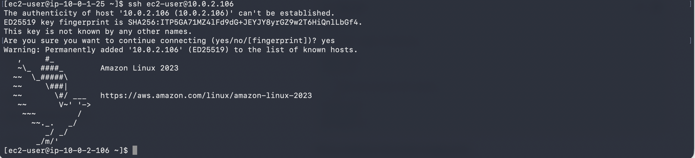

This demonstrates bastion/jump-host style administration.

---

## 13. Test Private EC2 Internet Connectivity Through NAT

From the private EC2 instance:

```bash
curl https://checkip.amazonaws.com
```

The request returned the public IP associated with the NAT Gateway rather than a public IP assigned to the private EC2 instance.

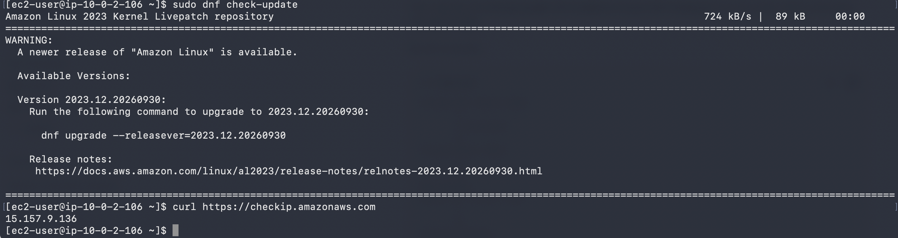

This confirms the traffic path:

```text
Private EC2
    ↓
Private Route Table
    ↓
NAT Gateway
    ↓
Internet Gateway
    ↓
Internet
```

---

## 14. Verify Package Repository Connectivity

Outbound HTTPS/package repository access was tested from the private instance:

```bash
sudo dnf check-update
```

The private EC2 instance successfully contacted the Amazon Linux repositories and detected an available Amazon Linux release.

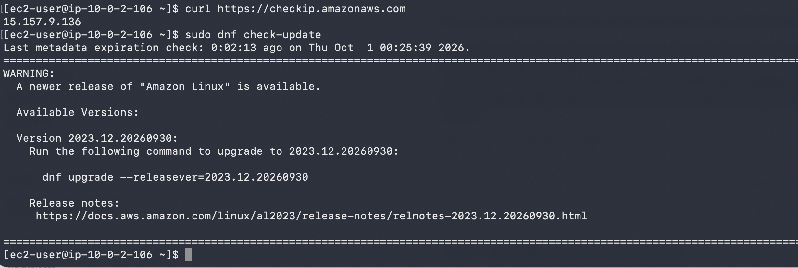

This further confirms that NAT-based outbound Internet connectivity was functioning correctly.

---

## 15. Final Architecture Verification

The final VPC Resource Map was reviewed to verify the completed network topology.

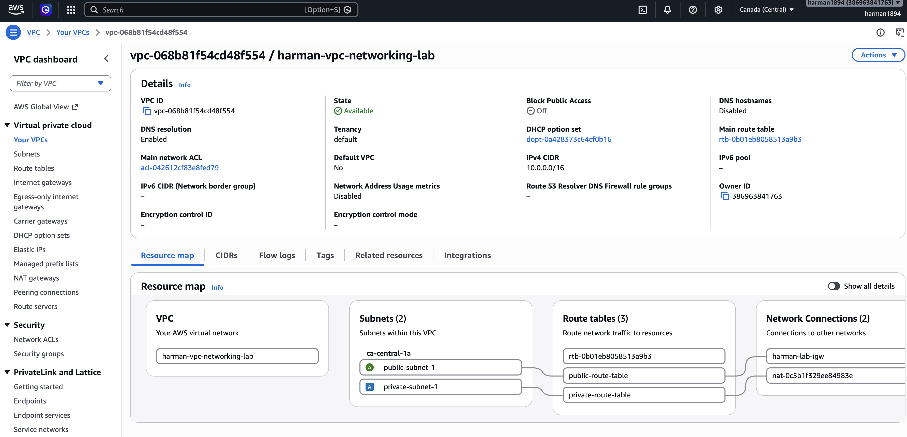

The completed architecture contained:

- Custom VPC
- Public subnet
- Private subnet
- Internet Gateway
- NAT Gateway
- Public route table
- Private route table
- Public EC2 instance
- Private EC2 instance
- Separate security groups
- Bastion/jump-host access
- NAT-based outbound Internet connectivity

---

# Security Design

Several security principles were demonstrated in this lab.

### Network Segmentation

Public-facing and internal resources were placed in separate subnets.

### No Public IP on Private EC2

The private EC2 instance was not assigned a public IPv4 address, reducing direct Internet exposure.

### Controlled Administrative Access

SSH access to the private instance was performed through the public EC2 jump host.

### Security Group Referencing

The private EC2 security group allowed SSH from the public EC2 security group rather than exposing SSH to the Internet.

### Outbound-Only Internet Access

The NAT Gateway allowed the private EC2 instance to initiate Internet connections without providing unsolicited inbound Internet connectivity to the instance.

### SSH Agent Forwarding

SSH agent forwarding was used during the lab instead of copying the private SSH key onto the bastion host.

---

# Troubleshooting Performed

During the project, several real-world networking and SSH issues were investigated.

### SSH Key Authentication

An initial SSH connection returned:

```text
Permission denied (publickey)
```

The correct EC2 key pair was identified and the private key permissions were configured:

```bash
chmod 400 aws-cyber-lab-key.pem
```

### Private Instance Connectivity

Connectivity between the public and private instances was tested using private IP addressing and SSH.

### NAT Connectivity

Outbound connectivity from the private EC2 instance was verified using:

```bash
curl https://checkip.amazonaws.com
```

### Package Repository Access

The private instance's ability to reach external package repositories was verified with:

```bash
sudo dnf check-update
```

These tests helped validate routing, NAT, security groups, and Linux network connectivity.

---

# AWS Services Used

- Amazon VPC
- Amazon EC2
- Amazon EBS
- Internet Gateway
- NAT Gateway
- Elastic IP
- Route Tables
- Security Groups
- Amazon Linux 2023

---

# Skills Demonstrated

- AWS VPC design
- CIDR planning
- Public/private subnet architecture
- Network segmentation
- Route table configuration
- Internet Gateway configuration
- NAT Gateway configuration
- EC2 deployment
- Security Group configuration
- Linux administration
- SSH authentication
- SSH agent forwarding
- Bastion/jump-host architecture
- Network troubleshooting
- Private subnet Internet connectivity
- AWS resource cleanup and cost awareness

---

# Resource Cleanup

After completing the lab and collecting evidence, temporary resources were cleaned up to avoid unnecessary AWS charges.

The lab EC2 instances were terminated, the NAT Gateway was deleted, and its Elastic IP address was released.

Resources belonging to a separate AWS project were preserved.

---

# Key Takeaways

This project demonstrated how AWS networking components work together to create a segmented cloud environment.

The most important concepts demonstrated were:

1. Public and private subnets serve different security purposes.
2. An Internet Gateway alone does not make every resource publicly accessible.
3. Route tables determine the path network traffic takes.
4. A NAT Gateway provides outbound Internet connectivity to private resources.
5. Security Groups provide stateful traffic filtering at the resource level.
6. Bastion/jump-host architecture can provide administrative access to private resources.
7. Connectivity should be validated from the operating system, not only from the AWS console.

---

## Author

**Harman Singh**